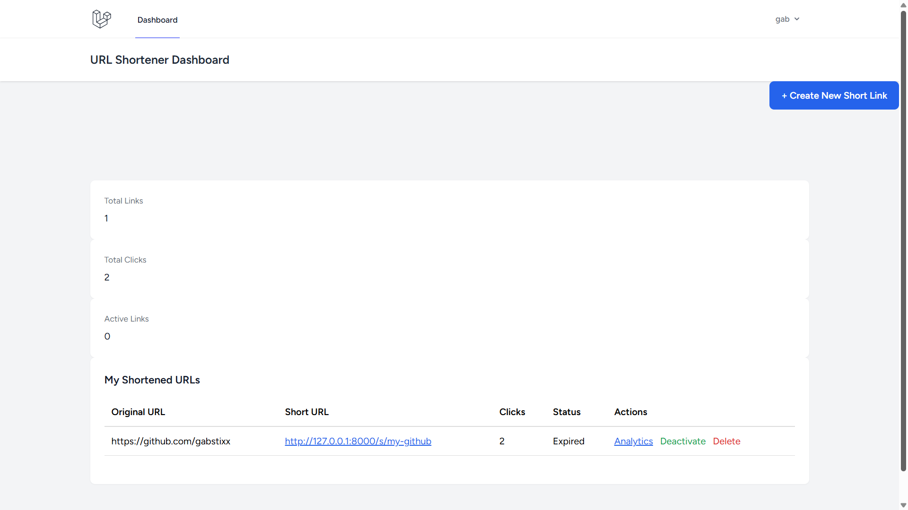
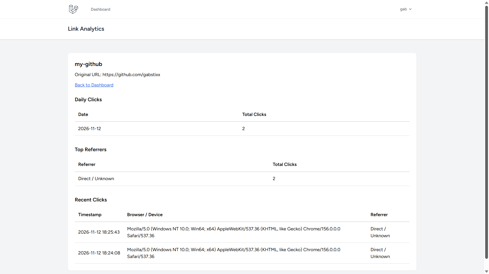

# Shortly — Laravel URL Shortener

A Laravel-based URL shortener that converts long URLs into short, shareable links and tracks click analytics.

## Features

- Shorten long URLs into unique six-character codes.
- Create custom aliases for shortened links.
- Set expiration dates for links.
- Redirect visitors to their original URLs.
- Track clicks, including IP addresses, browser information, and referrers.
- View daily click statistics and top referrer sources.
- User authentication and email verification.
- Dashboard with total links, clicks, and active links.
- Enable or deactivate shortened links.
- Delete shortened links.
- Rate limiting on link creation.
- Custom error page for expired or deactivated links.

## Tech Stack

- PHP
- Laravel 12
- MySQL
- Blade
- Tailwind CSS
- Laravel Breeze
- JavaScript

## Live Demo

[Shortly — URL Shortener](https://laravel-url-shortener.ethiodeploy.app)

## Screenshots

### Landing Page


### Registration


### Login


### Dashboard



### Link Analytics



## Local Setup

1. Clone the repository:

    ```bash
    git clone https://github.com/gabstixx/laravel-url-shortener.git
    ```

2. Enter the project directory:

    ```bash
    cd laravel-url-shortener
    ```

3. Install PHP dependencies:

    ```bash
    composer install
    ```

4. Install frontend dependencies:

    ```bash
    npm install
    ```

5. Create your environment file:

    ```bash
    cp .env.example .env
    ```

6. Generate an application key:

    ```bash
    php artisan key:generate
    ```

7. Configure your database credentials in `.env`.

8. Run migrations:

    ```bash
    php artisan migrate
    ```

9. Build frontend assets:

    ```bash
    npm run build
    ```

10. Start the development server:

    ```bash
    php artisan serve
    ```

## Running Tests

```bash
php artisan test
```

## Author

**Gabriel Komolafe**

GitHub: [gabstixx](https://github.com/gabstixx)
